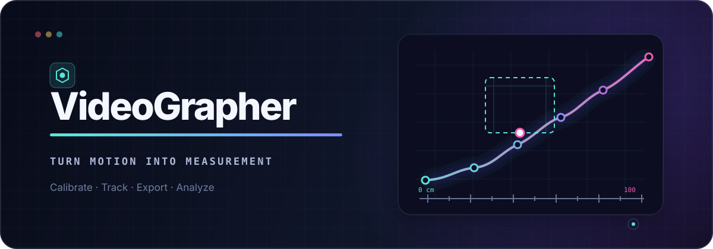

<div align="center">
  

  <br>

  <a href="https://github.com/ThatXliner/videographer"></a>
  
  
  

  <p>
    <strong>Turn ordinary video into calibrated, analysis-ready motion data.</strong><br>
    Track an object, correct for lens distortion, and export every frame as real-world coordinates.
  </p>

  <p>
    <a href="#quick-start">Quick start</a>
    ·
    <a href="#how-it-works">How it works</a>
    ·
    <a href="#data-toolkit">Data toolkit</a>
    ·
    <a href="#citation">Citation</a>
  </p>
</div>

---

VideoGrapher is a focused, interactive alternative to heavyweight video-analysis
software. Give it a video and a known-length reference stick; it gives you a
tracked video plus timestamped position data in pixels and centimeters.

It is especially handy for classroom physics, motion experiments, and quick
computer-vision measurements where lens distortion makes a single pixels-per-cm
ratio too crude.

## Why VideoGrapher?

| | Capability | What you get |
|:--:|---|---|
| 🎯 | **CSRT object tracking** | Robust frame-by-frame tracking from one hand-drawn bounding box |
| 📐 | **Interactive calibration** | A known-length ruler becomes a real-world coordinate system |
| 🪄 | **Distortion correction** | Draggable 10 cm ticks create a local, piecewise-linear scale |
| ⊹ | **Nine reference points** | Track any corner, edge midpoint, or the center of the object |
| 📦 | **Useful artifacts** | An annotated MP4 and a structured `position_data.json` |
| 📈 | **Analysis pipeline** | Export CSV, reject timestamp noise, and isolate linear motion |

> [!IMPORTANT]
> VideoGrapher uses interactive OpenCV windows and requires a graphical desktop.
> The object must be visible in the video's first frame.

## Quick start

### 1. Install

[`uv`](https://docs.astral.sh/uv/) is the shortest path:

```bash
git clone https://github.com/ThatXliner/videographer.git
cd videographer
uv sync
```

Or create your own Python 3.12+ environment and install the two runtime
dependencies:

```bash
python -m pip install "opencv-contrib-python>=4.8.0" "numpy>=1.24.0"
```

> [!NOTE]
> Use `opencv-contrib-python`, not `opencv-python`: the tracker depends on the
> contrib build's CSRT implementation.

### 2. Track

```bash
uv run main.py input.mp4 tracked.mp4
```

VideoGrapher opens a guided interface:

1. Mark both ends of a reference stick.
2. Drag the generated ticks onto the stick's real markings.
3. Draw a tight box around the object.
4. Choose the point on that box you want to measure.
5. Let the tracker process the video.

When it finishes, the working directory contains:

```text
tracked.mp4          annotated video with bounding box and position overlay
position_data.json   timestamps, coordinates, bounding boxes, and calibration
```

### 3. Export

Extract the tracked horizontal position as tab-separated data:

```bash
uv run to_csv.py position_data.json --axis x --header > position.tsv
```

Or extract the bottom of the box on the vertical axis, subtracting a 1 cm
offset:

```bash
uv run to_csv.py position_data.json \
  --reference bbox_bottom \
  --axis y \
  --offset 1 \
  --header > position.tsv
```

## How it works

```text
┌──────────────┐    ┌────────────────┐    ┌──────────────┐    ┌─────────────┐
│ Mark a ruler │ →  │ Adjust 10 cm   │ →  │ Select and   │ →  │ Export MP4 │
│ in frame 1   │    │ calibration    │    │ track object │    │ + JSON     │
└──────────────┘    └────────────────┘    └──────────────┘    └─────────────┘
       pixels       local scale in cm       CSRT per frame       analysis
```

### Calibration that bends with the image

A single global scale assumes every centimeter occupies the same number of
pixels. Real lenses often break that assumption.

VideoGrapher divides the reference stick into 10 cm segments. You can drag each
tick to its observed position, giving every segment its own local scale. For a
tracked point, the app finds the nearest segment, projects the point onto it,
interpolates the along-stick coordinate, and uses that segment's scale for the
perpendicular distance.

This approximation handles moderate barrel, pincushion, fisheye, and perspective
distortion without requiring a full camera-calibration rig.

> [!TIP]
> Put the reference stick in the same plane as the motion. Calibration cannot
> compensate for depth differences between the ruler and the tracked object.

### Pick the point that matches the experiment

```text
1  top-left       2  top-center       3  top-right
4  center-left    5  center           6  center-right
7  bottom-left    8  bottom-center    9  bottom-right
```

The default is **bottom-center**, which works well for an object moving along a
surface. Use the center for projectile motion, or an edge when measuring a
leading/trailing boundary.

## Command reference

```bash
uv run main.py VIDEO [OUTPUT] [--stick-length CM] [--no-calibrate]
```

| Argument | Default | Description |
|---|---:|---|
| `VIDEO` | required | Input video path |
| `OUTPUT` | `output.mp4` | Annotated output video path |
| `--stick-length CM` | `100.0` | Length of the visible reference stick |
| `--no-calibrate` | off | Skip calibration and retain pixel-only tracking |

During selection, press <kbd>Enter</kbd> to confirm, <kbd>R</kbd> to reset, or
<kbd>Esc</kbd> to cancel. During tracking, press <kbd>Q</kbd> to stop early.

## Output data

`position_data.json` preserves both the experiment metadata and the per-frame
measurements:

```json
{
  "metadata": {
    "video_path": "input.mp4",
    "output_path": "tracked.mp4",
    "total_frames": 300,
    "calibrated": true,
    "reference_point": "bottom-center",
    "calibration": {
      "reference_length_cm": 100.0,
      "tick_positions": [[120, 640, 0], [198, 632, 10]],
      "method": "piecewise linear interpolation with lens distortion correction"
    }
  },
  "tracking_data": [
    {
      "frame": 0,
      "timestamp": 0.0,
      "reference_point": "bottom-center",
      "position_x_pixels": 320,
      "position_y_pixels": 450,
      "position_x_cm": 42.5,
      "position_y_cm": 58.3,
      "bbox_pixels": {"x": 280, "y": 400, "w": 80, "h": 50},
      "bbox_cm": {"x": 37.2, "y": 51.8, "w": 10.6, "h": 6.5}
    }
  ]
}
```

Pixel values are always retained. Centimeter fields and `bbox_cm` are populated
when calibration is enabled.

## Data toolkit

The repository includes three small command-line tools for moving from raw
tracking output to analysis-ready data.

### JSON → delimited data

```bash
uv run to_csv.py position_data.json [options]
```

| Option | Default | Description |
|---|---:|---|
| `-r`, `--reference` | `position` | `position`, a box edge, or a box center |
| `-a`, `--axis` | `x` | Extract the `x` or `y` axis |
| `-o`, `--offset` | `0.0` | Subtract an offset from each position |
| `--header` | off | Include `timestamp` and `position_cm` |
| `--delimiter` | tab | Output delimiter |

Available box references are `bbox_top`, `bbox_bottom`, `bbox_left`,
`bbox_right`, `bbox_center_x`, and `bbox_center_y`.

### Clean noisy timestamps

`clean_csv.py` removes global timestamp outliers with the IQR rule, rejects
erroneous zero resets, and averages positions that share a timestamp.

```bash
uv run clean_csv.py raw.csv --header -o cleaned.csv
```

Tune detection with `--iqr-factor` (lower is more aggressive), or disable the
global pass with `--no-global-outliers`.

### Isolate constant-velocity motion

`clean_for_linearized.py` trims the beginning and end until it finds the longest
region meeting an R² threshold:

```bash
uv run clean_for_linearized.py cleaned.csv \
  --min-r2 0.95 \
  --min-points 5 \
  --header \
  -o linear.csv
```

The tools compose cleanly:

```bash
uv run clean_csv.py raw.csv --header |
  uv run clean_for_linearized.py /dev/stdin --min-r2 0.9 --header -o linear.csv
```

## Getting better measurements

- Lock the camera on a tripod and avoid changing zoom or focus mid-shot.
- Keep the ruler parallel to—and in the same plane as—the motion.
- Use bright, even lighting and a fast shutter to reduce motion blur.
- Select a compact bounding box with distinctive visual features.
- Align calibration ticks carefully; they determine the local scale.
- Validate a short test clip before processing a long recording.

CSRT can tolerate some scale change and partial occlusion, but it is still a
single-object visual tracker. Severe occlusion, abrupt appearance changes, or an
object leaving the frame can cause tracking loss.

## Project map

```text
videographer/
├── main.py                  interactive calibration and tracking
├── to_csv.py                JSON-to-delimited-data exporter
├── clean_csv.py             timestamp cleanup and duplicate averaging
├── manual_clean_csv.py      alternate/manual cleanup utility
├── clean_for_linearized.py  linear-region extraction
├── pyproject.toml           Python metadata and dependencies
└── CITATION.cff             machine-readable citation metadata
```

## Citation

If VideoGrapher helps your research, class, or project, please cite it:

```bibtex
@software{hu2025videographer,
  author  = {Hu, Bryan},
  title   = {VideoGrapher: Object Tracking with Lens Distortion Correction},
  year    = {2025},
  version = {0.1.0},
  url     = {https://github.com/ThatXliner/videographer}
}
```

Citation metadata is also available in [`CITATION.cff`](CITATION.cff).

## Contributing

Issues and pull requests are welcome. High-impact directions include automatic
object detection, multiple-object tracking, alternate trackers, and a unified
desktop interface.

<div align="center">
  <sub>Built with Python, OpenCV, and an unreasonable enthusiasm for plotting things that move.</sub>
</div>

HTTP and HTTPS video URLs are downloaded to a temporary file before tracking. HTTPS downloads use certifi's certificate bundle. The video backend reads local files only, so playlists that reference network segments are not supported.
